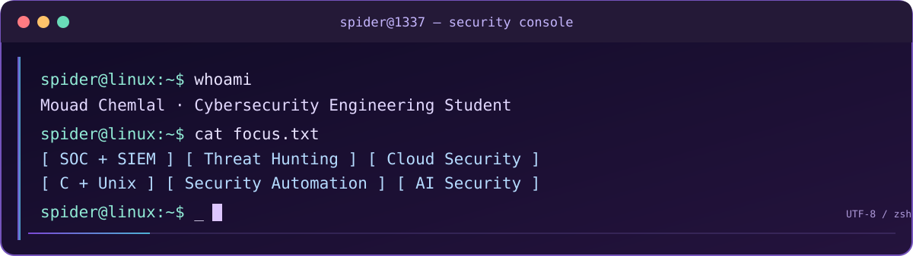
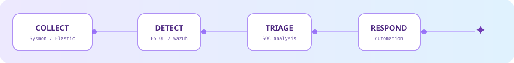

<!-- SPIDER | animated SVG profile | no raster image assets -->

  

  <a href="https://github.com/m-chemlal"><strong>GitHub</strong></a> &nbsp;·&nbsp;
  <a href="https://www.linkedin.com/in/m-chemlal/"><strong>LinkedIn</strong></a> &nbsp;·&nbsp;
  <a href="https://github.com/m-chemlal/1337_codings_school_projects"><strong>1337 / 42 Projects</strong></a>

  

### `01 / About the operator`

I'm **Mouad Chemlal (SPIDER)**, a **5th-year cybersecurity engineering student at ENSIASD Taroudant**, specializing in **Sécurité IT et Confiance Numérique**. I hold a **DUT in Génie Informatique** from **EST Fkih Ben Salah** and study **C, Unix and software engineering at 1337 Coding School (42 Network)**.

I focus on **SOC engineering, threat detection, security automation, systems and cloud security** — with growing interest in **AI security**.

### `02 / Orbital stack`

| Detection & SOC | Systems & programming | Cloud & automation |
|:--|:--|:--|
| Elastic Stack · Kibana · ES\|QL · Sysmon · Winlogbeat · Wazuh · MITRE ATT&CK | C · Python · JavaScript · Linux · Windows Server · Active Directory · Git | Docker · GCP · MQTT · n8n (notifications) · scikit-learn |

### `03 / Field projects`

| Project | Engineering notes |
|:--|:--|
| **Threat Hunting Lab** | Windows/AD + Sysmon + Winlogbeat + Elastic Stack; ES\|QL queries and MITRE ATT&CK mapping for security event investigations |
| **SOC & Alert Prioritization** | Wazuh + Elastic SOC prototype; Python/scikit-learn alert prioritization and n8n notification automation |
| **IoMT Mini SOC** | Python, Docker, MQTT and Google Cloud lab for simulated connected-device security monitoring |
| **[1337 Coding School projects](https://github.com/m-chemlal/1337_codings_school_projects)** | C, Unix and problem-solving exercises; repository is being organized |

Some internship/lab source code is not publicly available.

### `04 / GitHub activity telemetry`

<!-- Generated by lowlighter/metrics after running .github/workflows/activity-pulse.yml -->

The Activity Pulse appears after configuring `METRICS_TOKEN` and successfully running the workflow. No activity data is fabricated.

### `05 / Contribution snake`

<!-- Generated by Platane/snk; the output branch exists after the first successful workflow run. -->
<picture>
  <source media="(prefers-color-scheme: dark)" srcset="https://raw.githubusercontent.com/m-chemlal/m-chemlal/output/snake-dark.svg" />
  <source media="(prefers-color-scheme: light)" srcset="https://raw.githubusercontent.com/m-chemlal/m-chemlal/output/snake.svg" />
  
</picture>

### `06 / Current trajectory`

**ENSIASD Taroudant** · 5th year, IT Security & Digital Trust · expected 2027  
**1337 Coding School** · 42 Network · since 2026  
**EST Fkih Ben Salah** · DUT, Génie Informatique · 2022–2024

Working toward **SOC / Detection Engineering**, **Cloud Security**, and **AI Security**, with a strong foundation in Unix and C.

  <b>Open to a 6-month cybersecurity PFE starting January 2027</b> 
  <a href="https://www.linkedin.com/in/m-chemlal/">LinkedIn</a> ·
  <a href="https://github.com/m-chemlal">GitHub</a>

Visual inspiration: <a href="https://github.com/beydemirfurkan/awesome-github-profile">beydemirfurkan/awesome-github-profile</a> — Neon Pulse Banner, Typewriter Intro, Tech Sphere, Activity Pulse, and Snake Eat Graph. SVG artwork is customized for SPIDER.
